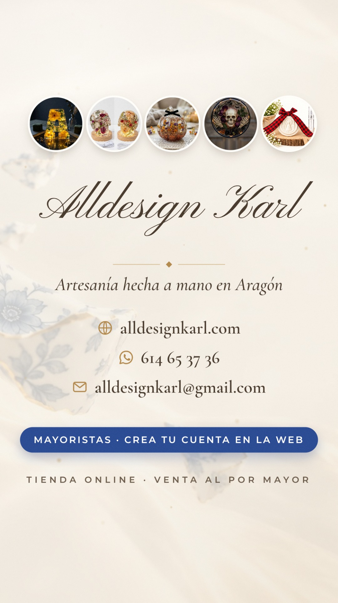

# Alldesign Karl · Vídeo de presentación para mayoristas

Vídeo vertical de **50 s** (1080×1920, 30 fps, H.264 + AAC) **con locución**, pensado para presentar
Alldesign Karl a tiendas y mayoristas: quiénes somos, cómo empezamos, cómo hacemos las piezas, los
productos, la calidad, la venta al por mayor y la tienda online [alldesignkarl.com](https://alldesignkarl.com).



## Archivos finales

| Archivo | Uso |
|---|---|
| [`video/AlldesignKarl_Presentacion_1080x1920.mp4`](video/AlldesignKarl_Presentacion_1080x1920.mp4) | Máxima calidad (enviar por correo, web, Instagram, TikTok, YouTube Shorts) |
| [`video/AlldesignKarl_Presentacion_WhatsApp_720p.mp4`](video/AlldesignKarl_Presentacion_WhatsApp_720p.mp4) | Versión ligera para enviar por WhatsApp |
| [`video/portada.jpg`](video/portada.jpg) | Portada / miniatura |
| [`audio/locucion.flac`](audio/locucion.flac) | La voz sola |
| [`audio/musica.flac`](audio/musica.flac) | La música sola (original, -14 LUFS) |

## Locución

Voz femenina en español de España, neuronal y natural (Kokoro, voz `ef_dora`), con subtítulos en
pantalla sincronizados con la voz (el vídeo se entiende también sin sonido).

| Tiempo | Frase |
|---|---|
| 0,8 s | «Hola, somos **Alldesign Karl**, un pequeño taller artesanal de Aragón.» |
| 5,0 s | «Todo empezó en casa, con nuestra pasión por las manualidades, y poco a poco se convirtió en nuestro trabajo.» |
| 11,3 s | «Hacemos cada pieza a mano, una a una, con flores naturales, resina cristalina y yeso cerámico.» |
| 17,1 s | «Letras personalizadas e iluminadas, calaveras y calabazas de resina, colgantes decorativos, y nuestro ambientador del Cachirulo.» |
| 24,6 s | «Muchas se personalizan con los colores y la inicial que elijas.» |
| 28,6 s | «Usamos materiales de primera calidad, y cada pieza es única.» |
| 32,8 s | «Colaboramos con tiendas y vendemos al por mayor, con condiciones especiales para profesionales.» |
| 38,2 s | «En nuestra tienda online creas tu cuenta de mayorista: pedido mínimo de cien euros y envío a toda Europa.» |
| 44,4 s | «Somos **Alldesign Karl**: artesanía hecha a mano en Aragón.» |

El texto está en [`tools/guion.json`](tools/guion.json): para cambiar una frase basta con editarla ahí y
volver a generar la voz y el vídeo (ver *Regenerarlo*). La marca se pronuncia «Ol-disáin Karl».

## Guion visual

| Tiempo | Imagen | Rótulos |
|---|---|---|
| 0,0–4,7 s | Las piezas de porcelana de la portada de la web flotando; el nombre se escribe como con tinta. | *TALLER ARTESANAL · ARAGÓN* · **Alldesign Karl** · *La belleza de lo artesanal, en cada detalle.* · *HECHO A MANO EN ARAGÓN* (con la señal de Aragón) |
| 4,7–10,9 s | **Vuestra foto** en una polaroid; al decir «manualidades» caen tres polaroids pequeñas (flores, resina, yeso). | *CÓMO EMPEZAMOS* · **Nuestra historia** · *Todo empezó en casa* |
| 10,9–16,7 s | Primeros planos: las flores de la letra decorada, la letra de resina, la calavera de resina y el relieve de yeso del ambientador. Cada material se marca cuando se nombra. | *ASÍ LO HACEMOS* · **A mano, una a una** · ✓ Hecho a mano ✓ Flores naturales ✓ Resina cristalina ✓ Yeso cerámico |
| 16,7–24,3 s | Carrusel de las seis piezas de la tienda, cada una al nombrarla: letra decorada, letra de resina iluminada, calavera de resina con flores, calabaza de resina con flores, colgante de resina Calavera y ambientador del Cachirulo. | *NUESTROS PRODUCTOS* · **Nuestras piezas** · nombre y detalle de cada pieza · 01/06… |
| 24,3–28,3 s | Las letras cambiando de color: la de resina con sus 8 colores de la tienda y la decorada con sus 4, con las muestras de color debajo. | *PERSONALIZADAS* · **Tus colores, tu inicial** · *Tú eliges el color y la inicial* |
| 28,3–32,5 s | Sello dorado «Primera calidad»; después sube y se abren en abanico las cinco calaveras con luz, cada una con sus rosas. | *Materiales de primera calidad* · **Piezas únicas** · *NO HAY DOS IGUALES* |
| 32,5–37,9 s | Se dibuja con trazo dorado una tienda con toldo azul y el letrero *TU TIENDA*; al decir «al por mayor» se encienden las luces del escaparate con las piezas dentro. | *PARA TIENDAS Y EMPRESAS* · **Venta a mayoristas** · *Tiendas · Floristerías · Regalos* · *CONDICIONES ESPECIALES PARA PROFESIONALES* |
| 37,9–44,1 s | **La tienda online de verdad** en un móvil: portada → productos → sección de mayoristas, donde se resaltan «Crea tu cuenta de mayorista», «Pedido mínimo de 100 €» y «Envío a toda Europa». | *NUESTRA TIENDA ONLINE* · **alldesignkarl.com** (se escribe) · pegatinas *100 € pedido mínimo* y *Envío a toda Europa* |
| 44,1–50,0 s | Cierre: miniaturas de las piezas, el nombre, el contacto y la llamada a los mayoristas. | **Alldesign Karl** · *Artesanía hecha a mano en Aragón* · alldesignkarl.com · 614 65 37 36 · alldesignkarl@gmail.com · *MAYORISTAS · CREA TU CUENTA EN LA WEB* · *TIENDA ONLINE · VENTA AL POR MAYOR* |

Música original sintetizada para el vídeo (Sol mayor, 92 BPM, sin derechos de terceros): guitarra
punteada y piano al empezar, después bajo, shaker y un pad cálido; se llena un poco en la parte de
mayoristas y la tienda, y resuelve en Sol con una campanita justo cuando aparece el cierre. Una
campanita suave marca cada cambio de escena y la música baja sola cuando habla la voz. Mezcla a
-14 LUFS con el pico real a -1,5 dB.

## De dónde sale todo

- **Productos, fotos y textos: de la tienda online.** Los nombres, descripciones, opciones de color y
  condiciones de mayorista se han leído del catálogo de Wix de alldesignkarl.com (13/10/2026). Las fotos
  son las de la tienda ([Alldesignakarl](https://github.com/AlldesignKarl/Alldesignakarl), `assets`).
- **La tienda es la de verdad.** `tienda/index.html` es una copia del código actual de la web.
  `tools/tienda.cjs` la abre en un Chromium local con tamaño de móvil y responde a sus llamadas a Wix
  con el catálogo real (`tools/catalogo.json`) y las fotos reales. No se conecta a nada externo.
- **Vuestra foto** (`assets/fotos/nosotros.webp`) se usa recortada por encima del rótulo que lleva la
  imagen original («Burnt out but make it fashion»), para que solo se vean vuestras caras.
- **Voz.** `tools/voz.py` sintetiza cada frase en local con [sherpa-onnx](https://github.com/k2-fsa/sherpa-onnx)
  y el modelo Kokoro v1.0 (licencia Apache 2.0), le da un toque de ecualización, compresión y sala, y
  calcula cuándo se dice cada trozo de subtítulo (`src/tiempos.js`). Se ha comprobado con reconocimiento
  de voz (Whisper) que todas las frases se entienden.
- **Composición.** `src/promo.html` monta el vídeo y todo depende solo del tiempo y de `src/tiempos.js`,
  así que cada render sale idéntico y los cambios de imagen caen justo con la voz.
  `tools/render_promo.cjs` captura cada fotograma (con varias submuestras en los movimientos rápidos) y
  `tools/build.py` las promedia, añade un grano fino contra el banding, mezcla voz y música y codifica.
- Tipografías de la marca: Pinyon Script y Cormorant Garamond (las de la web) y Montserrat, todas con
  licencia OFL (`assets/fonts`).

## Notas

- **Revisad la frase de la historia.** «Todo empezó en casa, con nuestra pasión por las manualidades, y
  poco a poco se convirtió en nuestro trabajo» está escrita de forma general porque la historia no está
  en la web. Si queréis contar algo más concreto (cuándo empezasteis, quién hace qué…), se cambia en
  `tools/guion.json` y se regenera.
- **Precios ocultos.** El vídeo no enseña precios de las piezas (cambian con el tiempo); solo el pedido
  mínimo de 100 € y el envío a toda Europa, que son las condiciones de mayorista de la web.
- **Colores.** Las muestras son exactamente las opciones de la tienda: 8 colores en la letra de resina
  y 4 en la letra decorada.
- Para otra voz (masculina: `em_alex`), cambiad `"voz"` en `tools/guion.json`.

## Regenerarlo

Requisitos: Node 18+ con Playwright (Chromium), Python 3 con numpy, scipy, Pillow, soundfile y
sherpa-onnx, y ffmpeg. El modelo de voz (~330 MB) se descarga solo la primera vez en `build/modelos`.

```bash
pip install sherpa-onnx soundfile numpy scipy pillow
python3 tools/voz.py                                  # locución + tiempos de los subtítulos
NODE_PATH=$(npm root -g) node tools/tienda.cjs        # captura de la tienda online
python3 tools/prep.py                                 # material (recortes, tamaños)
python3 tools/build.py --fresh                        # render, música, mezcla y vídeo final
# fotogramas sueltos para revisar sin renderizar todo:
NODE_PATH=$(npm root -g) node tools/render_promo.cjs --stills 2,9,20,40,48 --out build/stills
```

Para verlo animado (sin sonido) en el navegador: sirve la carpeta del repositorio y abre
`src/promo.html?play` (después de `tools/prep.py`, porque usa `build/prep`).
